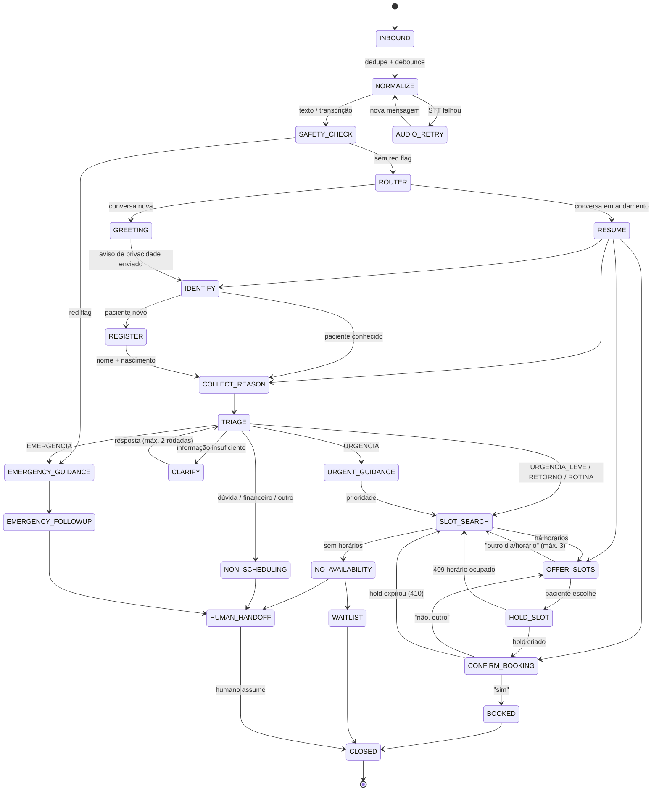

# 02 · Fluxo Conversacional (Máquina de Estados)

> Parte do projeto técnico do Agente de IA para WhatsApp. Índice em [`docs/README.md`](./README.md).

## 1. Níveis de urgência

O pedido original citava 4 níveis. Recomendo **5**, porque "precisa de hospital agora" e "precisa da dentista hoje" exigem roteamentos completamente diferentes:

| Nível | Código | Exemplo | Ação do bot | Prazo de atendimento |
|---|---|---|---|---|
| 🔴 Emergência | `EMERGENCIA` | Inchaço que se espalha para olho/pescoço, dificuldade para respirar ou engolir, sangramento que não para com compressão, trauma facial com desmaio/confusão, febre alta com inchaço | **Não agenda.** Orienta pronto-socorro / SAMU 192 imediatamente. Alerta plantão. | Imediato (hospital) |
| 🟠 Urgência | `URGENCIA` | Dor forte que não passa com o analgésico habitual, dente permanente arrancado (avulsão), dente quebrado com dor, inchaço localizado sem febre, sangramento pós-extração que volta | Orientação de primeiros cuidados + **primeiro horário disponível** (slots reservados de encaixe) + alerta ao plantão se configurado. | Mesmo dia / próximo dia útil cedo |
| 🟡 Urgência leve | `URGENCIA_LEVE` | Restauração caiu sem dor, coroa/provisório solto, sensibilidade ao frio, fio do aparelho machucando | Agenda nos próximos dias úteis. | 24–72 h |
| 🔵 Retorno | `RETORNO` | Revisão pós-procedimento, manutenção ortodôntica, retorno solicitado pela doutora | Agenda respeitando o intervalo indicado; preferência pelo mesmo profissional. | Conforme plano |
| 🟢 Rotina | `ROTINA` | Limpeza, avaliação, clareamento, check-up, orçamento | Agenda no primeiro horário conveniente para o paciente. | Livre |

Regra de ouro: **na dúvida entre dois níveis, escolha o mais grave.** Regras determinísticas podem elevar o nível definido pelo LLM, nunca reduzi-lo.

## 2. Diagrama de estados



### Interrupções globais (valem em **qualquer** estado)

| Gatilho | Transição |
|---|---|
| Red flag detectada (regra ou LLM) | → `EMERGENCY_GUIDANCE` (mesmo no meio de uma confirmação de horário) |
| Paciente pede humano ("quero falar com uma pessoa", "atendente") | → `HUMAN_HANDOFF` |
| Paciente pede para parar / revoga consentimento ("pare", "não quero mais mensagens") | → `OPT_OUT` → `CLOSED` |
| Paciente quer cancelar/remarcar consulta existente | → sub-fluxo `MANAGE_APPOINTMENT` |
| Sintoma novo ou piora relatada | → `TRIAGE` (re-triagem) |
| Inatividade de 15 min | lembrete único: "Ainda está por aí? Se preferir, continuamos depois." |
| Inatividade de 2 h | → `CLOSED` (libera *hold*, salva contexto por 24 h para `RESUME`) |
| 3 mensagens seguidas sem progresso (loop) | → `HUMAN_HANDOFF` |

## 3. Estados em detalhe

### `INBOUND` → `NORMALIZE` → `SAFETY_CHECK`
Ver pipeline em `01-arquitetura.md` §5. Esses estados são técnicos e não geram mensagem ao paciente (exceto `AUDIO_RETRY`).

### `GREETING`
Determina se está **fora do horário** (`clinic.business_hours`, fuso `America/Sao_Paulo`, feriados cadastrados).

> 🦷 Olá! Aqui é a Lia, assistente virtual da **Clínica Sorriso**. No momento estamos fora do horário de atendimento (seg a sex, 8h às 18h), mas eu posso te ajudar a **agendar uma consulta** ou **orientar em caso de urgência**.
>
> Seus dados são usados só para o seu atendimento, conforme nossa política de privacidade: {{link_curto}}
>
> **Se for uma emergência grave (dificuldade para respirar ou engolir, inchaço que se espalha pelo rosto ou sangramento que não para), procure agora o pronto-socorro ou ligue 192.**
>
> Me conta: como posso te ajudar?

Se o paciente já começou descrevendo o problema na primeira mensagem, o bot **não repete a pergunta** — pula para `IDENTIFY` aproveitando o texto como motivo.

Durante o horário comercial, comportamento configurável: (a) responder normalmente e marcar para a recepção ver, ou (b) só confirmar recebimento e transferir.

### `IDENTIFY` / `REGISTER`
- Busca por `phone_hash` (`POST /patients/lookup`).
- **Encontrado:** "Que bom te ver de novo, {{primeiro_nome}}!" — sem confirmar outros dados por mensagem (o número pode ter mudado de dono; não expor histórico).
- **Não encontrado:** coletar **apenas** nome completo e data de nascimento. Nada de CPF, endereço ou convênio pelo bot (coletados presencialmente). Menos dados = menos risco.
- **Menor de 18 anos** (pela data de nascimento): pedir nome do responsável e confirmar que é o responsável quem está conversando.
- O bot pode estar falando com alguém agendando para outra pessoa ("é para minha mãe"): registrar o paciente real e o contato como `contact_relation`.

### `COLLECT_REASON` / `CLARIFY`
Pergunta aberta: "Qual o motivo do contato? Pode escrever ou mandar um áudio."

Se o motivo for sintoma, o LLM faz **no máximo 2 rodadas** de perguntas objetivas para classificar (agrupadas numa mensagem só):
- Há quanto tempo? A dor é contínua ou vem e vai?
- De 0 a 10, qual a intensidade? Melhora com analgésico?
- Tem inchaço? Onde? Está aumentando?
- Tem febre, dificuldade para abrir a boca, engolir ou respirar?
- Fez algum procedimento recente (extração, canal)?

### `TRIAGE`
O LLM chama a tool `record_triage` (ver doc 03) com `urgency_level`, `red_flags[]`, `chief_complaint`, `suggested_service`, `confidence`. O worker:
1. Combina com as regras determinísticas: `nivel_final = max(nivel_llm, nivel_regras)`.
2. Se `confidence < 0.6` e nível ≤ `URGENCIA_LEVE` → mais uma rodada de `CLARIFY` (se ainda houver) ou sobe um nível.
3. Grava `triage_records` (com versões do prompt e das regras, para auditoria).
4. Publica `triage.created` no dashboard (a doutora vê a fila de triagens da noite).

### `EMERGENCY_GUIDANCE` (exceção crítica)
Mensagem **fixa, escrita por humano e revisada pela doutora** — não gerada pelo LLM, para não haver variação:

> ⚠️ **Pelo que você descreveu, isso pode ser uma emergência e precisa de atendimento imediato.**
>
> 👉 **Vá agora ao pronto-socorro mais próximo ou ligue 192 (SAMU).**
>
> Não espere a clínica abrir. Se estiver com dificuldade para respirar, ligue 192 agora.
>
> Já avisamos a equipe da clínica. Assim que possível, entraremos em contato.

Variações específicas (também fixas), anexadas quando o red flag for:
- **Dente permanente arrancado:** "Segure o dente pela coroa (parte branca), sem tocar na raiz. Se estiver sujo, enxágue rapidamente com leite ou soro, sem esfregar. Coloque em um copo de **leite** ou soro fisiológico e procure atendimento **em até 1 hora** — quanto antes, maior a chance de salvar o dente." → para avulsão, o nível é `URGENCIA` se houver dentista de plantão disponível, senão `EMERGENCIA` com orientação de pronto-socorro odontológico.
- **Sangramento:** "Morda uma gaze limpa dobrada sobre o local, com pressão firme, por 30 minutos sem soltar. Não faça bochechos."
- **Trauma na cabeça com desmaio, vômito ou confusão:** priorizar pronto-socorro geral.

Ações em paralelo:
- `POST /alerts/on-call` → notificação para o celular da doutora/plantonista (template WhatsApp *utility* + push no dashboard).
- Conversa marcada `emergency=true`; o bot **não oferece agendamento** nesta conversa até um humano liberar.

### `EMERGENCY_FOLLOWUP`
Se o paciente continuar escrevendo, o bot repete de forma curta a orientação de ir ao hospital e informa que a equipe foi avisada. Nunca tenta acalmar dizendo que "provavelmente não é nada".

### `URGENT_GUIDANCE`
Mensagem empática + cuidados gerais seguros (compressa fria por fora do rosto, 15 min com intervalos; evitar mastigar do lado afetado; manter higiene suave) + **sem indicação de medicamento ou dose** (o paciente pode seguir a orientação que já recebeu de um profissional ou bula). Depois busca slots com `urgency=URGENCIA` (inclui encaixes reservados). Se não houver encaixe em 24 h → aciona plantão (`POST /alerts/on-call` com severidade `high`) e `HUMAN_HANDOFF`.

### `SLOT_SEARCH` / `OFFER_SLOTS`
- Pergunta preferência apenas se o nível for `ROTINA`/`RETORNO`: "Prefere manhã ou tarde? Algum dia da semana?"
- `GET /availability` com `service_id`, `urgency_level`, janela (urgência leve: 3 dias úteis; rotina: 21 dias).
- Oferece **até 3 opções** como *list message* interativa do WhatsApp (mais fácil que digitar):
  > Tenho estes horários com a **Dra. Ana** para **Avaliação**:
  > 1️⃣ Ter, 10/11 às 9h00
  > 2️⃣ Ter, 10/11 às 14h30
  > 3️⃣ Qua, 11/11 às 10h00
  > Qual fica melhor? Se nenhum servir, me diga outro dia.
- Interpretação de respostas livres ("o de terça de manhã", "o primeiro", "quarta") é feita pelo LLM, que **só pode escolher entre os `slot_id` retornados** pela API.

### `HOLD_SLOT`
`POST /slot-holds`. Se `409` (alguém pegou): "Esse horário acabou de ser preenchido 😕. Veja outras opções:" → `SLOT_SEARCH`.

### `CONFIRM_BOOKING`
Resumo explícito e pedido de confirmação com botões (*reply buttons*: ✅ Confirmar / 🔄 Outro horário):
> Confirmando: **Avaliação** com **Dra. Ana**, **terça, 10/11, às 9h00**, na Rua X, 123. Posso confirmar?

### `BOOKED`
`POST /appointments` (com `Idempotency-Key`). Mensagem baseada no **retorno da API** (nunca no que o LLM "acha" que marcou):
> ✅ **Agendamento confirmado para terça, 10/11, às 9h00** com a Dra. Ana.
> 📍 Rua X, 123 — Sala 4
> Chegue 10 min antes e traga um documento com foto. Enviaremos um lembrete na véspera. Para remarcar, é só mandar mensagem aqui.

Evento `appointment.created` aparece no dashboard em tempo real.

### `NO_AVAILABILITY` / `WAITLIST`
"Não encontrei horários nesse período. Posso te colocar na **lista de espera** e te aviso se abrir uma vaga, ou peço para a recepção falar com você amanhã cedo. O que prefere?"

### `NON_SCHEDULING`
Dúvidas de preço, convênio, endereço: responder **apenas** com base em FAQ cadastrada pela clínica (injetada no contexto); o que não estiver na FAQ → "Vou deixar sua pergunta para a equipe, que responde a partir das 8h." → `HUMAN_HANDOFF`.

### `HUMAN_HANDOFF`
Cria `handoff` no dashboard com resumo gerado (Haiku), nível de urgência e transcrição. O bot para de responder livremente nessa conversa (só confirma recebimento) até a equipe devolver o controle.

### `MANAGE_APPOINTMENT` (sub-fluxo)
- Lista só agendamentos **futuros** do paciente da conversa.
- Cancelar: confirmação explícita → `POST /appointments/{id}/cancel`.
- Remarcar: `SLOT_SEARCH` com o mesmo serviço → `PATCH` com novo `hold_id` (o horário antigo só é liberado após o novo estar confirmado).
- Cancelamento com menos de 24 h: aplicar política da clínica (aviso, sem cobrança automática pelo bot).

## 4. Tabela de exceções

| Situação | Tratamento |
|---|---|
| Emergência grave | `EMERGENCY_GUIDANCE` com texto fixo, SAMU 192, alerta ao plantão, sem agendamento |
| Paciente minimiza sintomas graves ("é só um inchaço no olho, nada demais") | A regra detecta "inchaço" + "olho" → emergência mesmo assim |
| Ideação suicida, violência doméstica | Fora do escopo odontológico, mas **não ignorar**: mensagem fixa com CVV 188 / 190 e handoff com prioridade máxima |
| Paciente pede diagnóstico ("é cárie?", "preciso de canal?") | "Só a doutora consegue avaliar com segurança na consulta. Posso agendar uma avaliação?" |
| Paciente pede remédio | Não indicar nem dose. Orientar a seguir prescrição prévia ou procurar farmácia/pronto atendimento; oferecer agendamento |
| Áudio inaudível / em outro idioma | `AUDIO_RETRY`; após 2 falhas → pedir texto ou handoff |
| Imagem de dente/foto | Não analisar; "a doutora verá na consulta"; anexar ao handoff |
| Mensagem ofensiva | Uma resposta neutra; reincidência → encerra e marca para revisão |
| Tentativa de prompt injection | Ignorada pelas regras do prompt; tools não permitem dados de terceiros |
| Paciente escolhe horário que não foi oferecido | Rodar `SLOT_SEARCH` para aquele horário específico; se indisponível, dizer e oferecer próximos |
| API de agendamento fora | Não prometer horário; registrar pedido pendente para recepção; avisar o paciente |
| LLM fora / lento | Resposta padrão + red flags determinísticas continuam ativas |
| Mesmo paciente, duas conversas paralelas (dois aparelhos) | `wa_id` diferente → conversas diferentes; a API impede overbooking de qualquer forma |
| Paciente já tem consulta marcada | Avisar ("Você já tem consulta na quinta às 9h. Quer remarcar ou marcar outra?") |
| Fora da janela de 24 h do WhatsApp | Só templates aprovados (lembrete, confirmação) |

## 5. Contexto passado ao LLM a cada turno

```json
{
  "state": "OFFER_SLOTS",
  "clinic": { "name": "Clínica Sorriso", "is_open_now": false, "next_opening": "2026-11-10T08:00:00-03:00" },
  "patient": { "known": true, "first_name": "Carla", "is_minor": false },
  "triage": { "urgency_level": "URGENCIA_LEVE", "chief_complaint": "restauração caiu, sem dor" },
  "offered_slots": [
    { "slot_id": "slt_9f2", "label": "Ter, 10/11 às 9h00", "practitioner": "Dra. Ana" }
  ],
  "allowed_tools": ["hold_slot", "search_availability", "request_human_handoff"],
  "conversation_summary": "Paciente relatou restauração caída no dente de trás há 2 dias, sem dor."
}
```

Observação: o LLM recebe só o **primeiro nome**, nunca telefone, data de nascimento ou IDs internos de paciente.

## 6. Testes do fluxo

- **Testes unitários da FSM** (sem LLM): cada transição e cada interrupção global.
- **Suite de triagem** com ≥ 200 casos rotulados pela doutora (incluindo gírias, erros de digitação e transcrições ruins). Métrica crítica: **zero falsos negativos de emergência**; aceitar falsos positivos.
- **Testes de regressão do prompt**: rodar a suite a cada mudança de prompt ou de modelo; bloquear deploy se cair a sensibilidade de emergência.
- **Simulação de concorrência**: 50 conversas tentando o mesmo horário → exatamente 1 sucesso.
